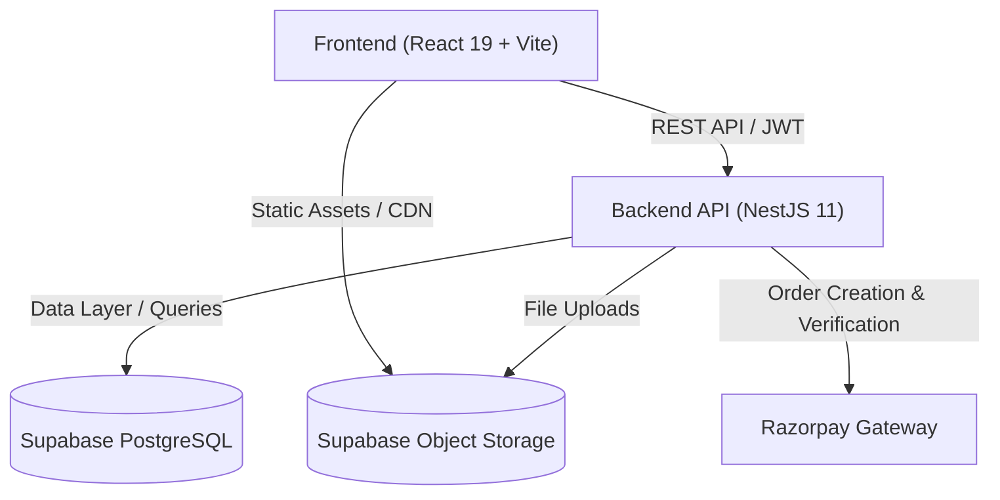

# 🛒 Binzo — 10-Minute Rapid Grocery Delivery Platform

<p align="center">
  
  
  
  
  
  
  <a href="https://www.figma.com/design/hy5Vibkv2CirbqhWbstdW2/Binzo?node-id=70-1054&t=HdqinwGe20kZcMTu-0" target="_blank"></a>
</p>

<p align="center">
  <b>Binzo</b> is a modern, high-performance quick-commerce grocery delivery platform built with <b>React 19</b>, <b>NestJS</b>, and <b>Supabase</b>. It provides an ultra-fast grocery shopping experience with real-time order tracking, comprehensive catalog browsing, cart management, and a full-featured admin management dashboard.
</p>

---

## 📑 Table of Contents

- [Features](#-features)
- [UI/UX Design](#-uiux-design)
- [Architecture & Tech Stack](#-architecture--tech-stack)
- [Project Structure](#-project-structure)
- [Database Schema & ER Diagram](#-database-schema--er-diagram)
- [Getting Started](#-getting-started)
  - [Prerequisites](#prerequisites)
  - [Environment Variables](#environment-variables)
  - [Database Setup](#database-setup)
  - [Installation & Running Locally](#installation--running-locally)
- [API Overview](#-api-overview)
- [Deployment](#-deployment)
- [Contributing](#-contributing)
- [License](#-license)

---

## ✨ Features

### 🛍️ Customer Experience
- **Dynamic Catalog & Category Browsing**: Smooth, responsive interface for exploring fresh produce, dairy, bakery, snacks, and daily essentials.
- **Product Variants & Unit Selector**: Multi-unit pricing (e.g. 500g, 1kg, multi-packs) with real-time discount and price calculations.
- **Real-Time Persistent Cart**: Instant addition, removal, and quantity updates with server and local synchronization.
- **Saved Delivery Addresses**: Manage multiple delivery addresses with latitude/longitude coordinates and custom tags (Home, Work, Other).
- **Payment Gateway Integration**: Secure checkout supporting Razorpay payments and Cash on Delivery (COD).
- **Interactive Live Delivery Tracking**: Visualized delivery partner tracking using Leaflet and OpenStreetMap, with dynamic status progression.
- **Order History & Invoices**: Detailed order receipts, status timelines, payment details, and breakdown summaries.

### 🛡️ Authentication & Security
- **Supabase Auth**: Email/password authentication, managed access and refresh tokens, and verified sessions.
- **Role-Based Access Control**: Protected routes and admin privilege verification.

### 📊 Admin Operations Dashboard (`/admin`)
- **Product & Inventory Management**: Create, update, toggle availability, manage units, and delete products.
- **Category Management**: Create and manage top-level grocery categories with custom icons and banners.
- **Order Lifecycle Dispatch**: Live order status updating (Pending $\to$ Confirmed $\to$ Out for Delivery $\to$ Delivered).
- **Analytics & Metrics**: Visual breakdown of total sales, active orders, customer stats, and revenue trends.

---

## 🎨 UI/UX Design

The application's interface, interactive components, responsive layout system, and design tokens are crafted in Figma.

👉 **[View the Binzo Figma Design File](https://www.figma.com/design/hy5Vibkv2CirbqhWbstdW2/Binzo?node-id=70-1054&t=HdqinwGe20kZcMTu-0)**

- **Design System Highlights**:
  - Primary Theme: Indigo (`#4F46E5`) & Fresh Lime Accent (`#DCE546`)
  - Typography: Clean typography powered by `Inter` & expressive branding via `Lobster`
  - Component Library: Mobile-first responsive category tiles, product cards with unit selectors, floating persistent cart drawer, live route tracking map layouts, and admin analytics dashboards.

---

## 🛠️ Architecture & Tech Stack



### Frontend
- **Framework**: [React 19](https://react.dev/)
- **Build Tool**: [Vite 8](https://vitejs.dev/)
- **Routing**: [React Router DOM v7](https://reactrouter.com/)
- **Styling**: CSS Modules (scoped styles, mobile-first responsive breakpoints)
- **Icons**: [FontAwesome Free 7](https://fontawesome.com/)
- **Mapping & Geolocation**: [Leaflet](https://leafletjs.com/) & [React-Leaflet](https://react-leaflet.js.org/)

### Backend
- **Framework**: [NestJS 11](https://nestjs.com/) (TypeScript)
- **Runtime**: [Node.js 22](https://nodejs.org/)
- **Authentication**: Supabase Auth; NestJS verifies access tokens with Supabase Auth
- **Validation**: `class-validator`, `class-transformer`
- **Database Client**: `@supabase/supabase-js`

### Database & Storage
- **Database**: [Supabase PostgreSQL](https://supabase.com/) with Row Level Security (RLS) policies
- **Media Storage**: Supabase Storage for product images and promotional banners

---

## 📂 Project Structure

```
binzo/
├── backend/                     # NestJS API Application
│   ├── src/
│   │   ├── common/              # Guards, decorators, filters, interceptors
│   │   ├── modules/
│   │   │   ├── address/         # Address CRUD and geolocation
│   │   │   ├── auth/            # Auth, JWT strategies, user registration
│   │   │   ├── cart/            # Shopping cart management
│   │   │   ├── category/        # Category management
│   │   │   ├── order/           # Orders, status pipeline, Razorpay integration
│   │   │   ├── product/         # Product catalog and inventory
│   │   │   └── supabase/        # Supabase client service provider
│   │   ├── app.module.ts        # Main application module
│   │   └── main.ts              # Entry point and CORS/pipeline configuration
│   ├── package.json
│   └── tsconfig.json
│
├── frontend/                    # React + Vite Client Application
│   ├── public/                  # Static assets and images
│   ├── src/
│   │   ├── assets/              # Icons and SVGs
│   │   ├── components/          # Reusable UI components (Navbar, Cart, Hero, Modals)
│   │   ├── context/             # Global Auth and Cart context providers
│   │   ├── data/                # Fallback fixtures and domain types
│   │   ├── pages/               # Routed pages (Home, Orders, Details, Admin)
│   │   ├── services/            # Axios / Fetch API client services
│   │   ├── styles/              # Global styling variables and resets
│   │   ├── App.tsx              # React router configuration
│   │   └── main.tsx             # Application bootstrap
│   ├── package.json
│   └── vite.config.ts
│
├── schema.sql                   # Supabase database schema & indexes
├── local-public-data.sql        # Seed data for initial catalog and categories
├── Binzo ER Diagram.pdf         # Entity Relationship Diagram (PDF)
├── Binzo ER Diagram.jpg         # Entity Relationship Diagram (Visual Image)
├── render.yaml                  # Cloud deployment configuration for Render
├── package.json                 # Monorepo root orchestration script
└── README.md
```

---

## 🗄️ Database Schema & ER Diagram

The database architecture is designed for quick-commerce performance:

- **`users`**: Profiles, phone numbers, role-based access (`customer`, `admin`, `rider`).
- **`addresses`**: User delivery points with street, city, pin code, and geographical coordinates.
- **`categories`**: Hierarchical grocery categories with icons and display ordering.
- **`products`**: Catalog items with descriptions, dietary tags, category relations, and base metadata.
- **`product_units`**: SKUs with distinct sizes (e.g., 250g, 500g, 1L), MRP, discount prices, and stock units.
- **`cart_items`**: User cart persistence linked to specific product units.
- **`orders`**: Order records with delivery addresses, total amounts, delivery fees, and order status.
- **`order_items`**: Line items snapshotting product pricing at the moment of order placement.
- **`payments`**: Payment records tracking Razorpay transaction IDs, status (`PENDING`, `COMPLETED`, `FAILED`), and methods.

> 📄 For the complete visual entity relationship model, refer to [Binzo ER Diagram.jpg](./Binzo%20ER%20Diagram.jpg) or [Binzo ER Diagram.pdf](./Binzo%20ER%20Diagram.pdf).

---

## 🚀 Getting Started

### Prerequisites
- **Node.js**: `v22.x` or higher
- **npm**: `v10.x` or higher
- **Supabase Account**: A free project on [supabase.com](https://supabase.com) (or a local Supabase CLI instance)

### Environment Variables

#### 1. Backend Configuration
Create a `.env` file in the `backend/` directory:

```env
PORT=3000
FRONTEND_URL=http://localhost:5173

# Supabase Credentials
SUPABASE_URL=https://your-project.supabase.co
SUPABASE_ANON_KEY=your-supabase-anon-key
SUPABASE_SERVICE_ROLE_KEY=your-supabase-service-role-key

# Razorpay (Optional for payment gateway testing)
RAZORPAY_KEY_ID=your_razorpay_key_id
RAZORPAY_KEY_SECRET=your_razorpay_key_secret
```

#### 2. Frontend Configuration
Create a `.env` file in the `frontend/` directory:

```env
VITE_API_BASE_URL=http://localhost:3000/api
```

### Database Setup
Use the Supabase CLI for local database work. Migrations in `supabase/migrations/` are the schema source of truth:

```bash
supabase start
supabase db reset
supabase status
```

`db reset` recreates the local database and applies every migration. The migration `20261015100000_switch_to_supabase_auth.sql` removes old custom-auth accounts and their cart, address, and order records, then links `public.users` profiles to `auth.users`. It keeps the catalog intact.

The local Auth configuration has email confirmations disabled, so local sign-up returns a session. After creating the account you want to administer, promote its profile once in local Studio SQL Editor:

```sql
UPDATE public.users SET role = 'admin' WHERE email = 'your-email@example.com';
```

Hosted projects should use their own Supabase Auth email confirmation settings. The local reset does not push migrations to a hosted project.

### Google OAuth Setup

The auth modal starts a PKCE Google sign-in through Supabase Auth and returns to `/auth/callback`. To enable it locally:

1. Create a **Web application** OAuth client in Google Cloud. Add `http://localhost:5173` as an authorized JavaScript origin and `http://127.0.0.1:50321/auth/v1/callback` as an authorized redirect URI.
2. Put the Google client ID and secret in the ignored repo-root `.env` using the keys shown in [`.env.example`](./.env.example).
3. Set `enabled = true` in `[auth.external.google]` in `supabase/config.toml`, then restart the local Supabase stack with `supabase stop` and `supabase start`.
4. Confirm `frontend/.env.local` has the local Supabase URL and publishable key, then restart Vite.

For the hosted project, enable Google in Supabase Dashboard → Authentication → Providers and add that project's Supabase Auth callback URL to the Google OAuth client's authorized redirect URIs. Add the production app callback to Supabase's allowed redirect URLs too. Local provider settings and credentials are separate from the hosted project's configuration.

### Installation & Running Locally

Install dependencies for root and all workspaces:

```bash
npm install
npm install --prefix backend
npm install --prefix frontend
```

Start both backend and frontend concurrently with one command:

```bash
npm run dev
```

- **Frontend**: `http://localhost:5173`
- **Backend API**: `http://localhost:3000/api`

---

## 📡 API Overview

| Method | Endpoint | Description | Auth Required |
|---|---|---|---|
| `POST` | `/api/auth/register` | Register a new user | No |
| `POST` | `/api/auth/login` | Log in and obtain a Supabase Auth session | No |
| `POST` | `/api/auth/refresh` | Refresh a Supabase Auth session | No |
| `POST` | `/api/auth/logout` | Revoke the current Supabase Auth session | Yes |
| `GET` | `/api/category` | Fetch all grocery categories | No |
| `GET` | `/api/product` | Fetch product catalog with filtering & units | No |
| `GET` | `/api/product/:id` | Fetch specific product details and units | No |
| `GET` | `/api/cart` | Get current user's active cart | Yes |
| `POST` | `/api/cart/item` | Add or update an item in cart | Yes |
| `DELETE` | `/api/cart/item/:id` | Remove an item from cart | Yes |
| `GET` | `/api/address` | List all saved delivery addresses | Yes |
| `POST` | `/api/address` | Create a new delivery address | Yes |
| `POST` | `/api/order/create` | Place a new grocery order | Yes |
| `GET` | `/api/order` | Get user order history | Yes |
| `GET` | `/api/order/:id` | Get single order details & tracking data | Yes |
| `POST` | `/api/order/verify-payment`| Verify Razorpay payment signature | Yes |

---

## 🌐 Deployment

### Render (Full Stack)
The project includes a ready-to-use [`render.yaml`](./render.yaml) specification:

1. Connect your repository to [Render](https://render.com/).
2. Create a Blueprint Web Service using `render.yaml`.
3. Set the required secret environment variables (`SUPABASE_URL`, `SUPABASE_ANON_KEY`, `SUPABASE_SERVICE_ROLE_KEY`, `RAZORPAY_KEY_ID`, `RAZORPAY_KEY_SECRET`).
4. The deployment command builds both frontend and backend and serves the application seamlessly.

To build manually:
```bash
npm run build
```

---

## 🤝 Contributing

Contributions, issues, and feature requests are welcome!

1. Fork the repository
2. Create your feature branch (`git checkout -b feature/AmazingFeature`)
3. Commit your changes (`git commit -m 'Add some AmazingFeature'`)
4. Push to the branch (`git push origin feature/AmazingFeature`)
5. Open a Pull Request

---

## 📄 License

This project is licensed under the [MIT License](LICENSE).
